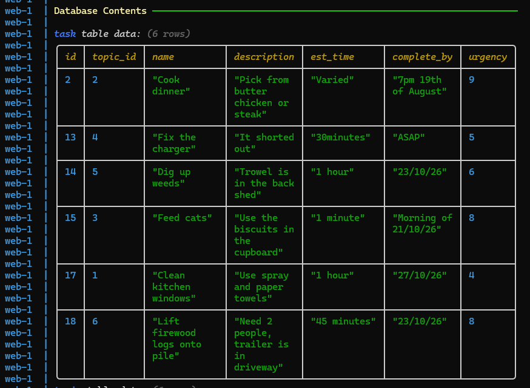
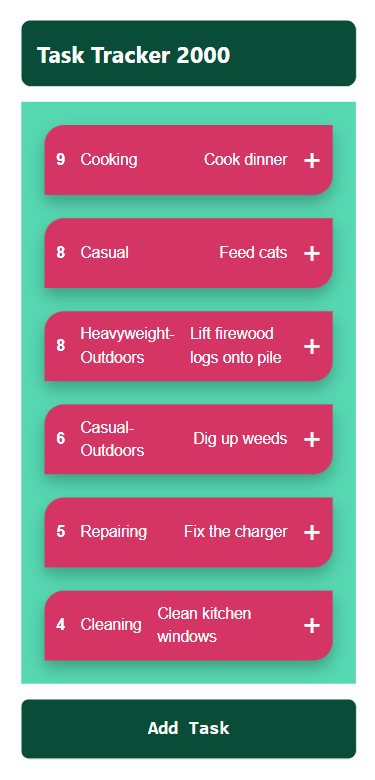
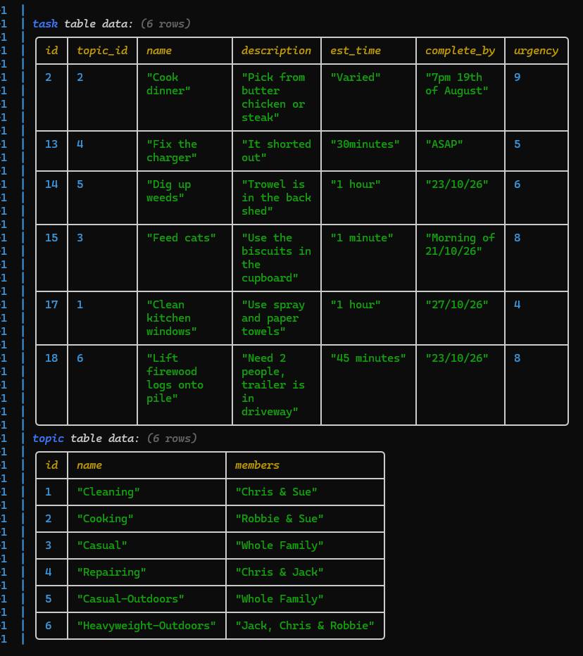
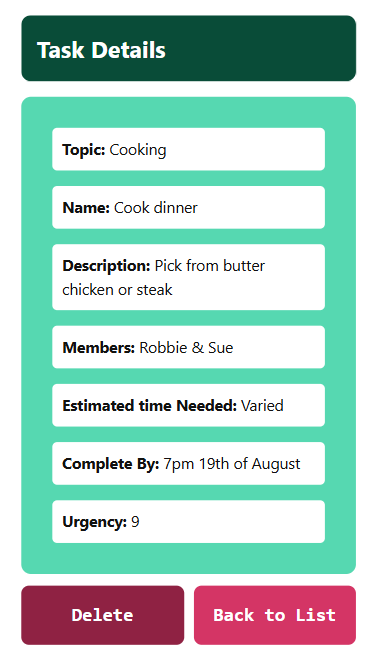

# Sprint 2 - Implement Database and Display of Test Data

## Sprint Goals

Implement the database, populated with test data. Create queries that retrieve test data, and display this on web pages as needed. Test and refine the queries and data display, so that it stands as the basis of the next sprint.

### Specific Goals

**Edit these goals as needed**

- Implement the database
- Add test data to the database
- Create the following web pages:
    - Home pages showing...
    - Details page for ...
    - Etc.
- Develop SQL database queries to:
    - Retrieve all ...
    - Retrieve specific ...
    - Etc.

## Testing if all the tasks show

I am testing whether all the tasks in the database show in the task list

**PLACE SCREENSHOTS AND/OR ANIMATED GIFS OF THE TESTING HERE**

### Changes / Improvements

The test went successful, the list shows all the tasks in the database

**PLACE SCREENSHOTS AND/OR ANIMATED GIFS OF THE IMPROVED SYSTEM HERE**

No improvements or changes were needed to improve or fix the database system

## Testing if all the details in the database show correctly in the detail page

I am testing wheter all the details of the tasks on the list match the ones on the database

**PLACE SCREENSHOTS AND/OR ANIMATED GIFS OF THE TESTING HERE**

### Changes / Improvements

The test went successful, all the details in the database match with the details in the task detail page

**PLACE SCREENSHOTS AND/OR ANIMATED GIFS OF THE IMPROVED SYSTEM HERE**

No improvements or changes were needed to improve or fix the details of the database system

## ETC...

## Sprint Review

This sprint went successful as all the details and tasks that was loaded onto the database were correctly displayed on the website