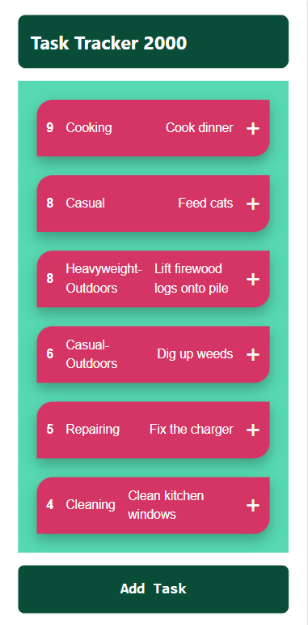
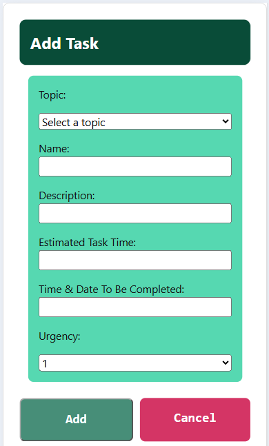
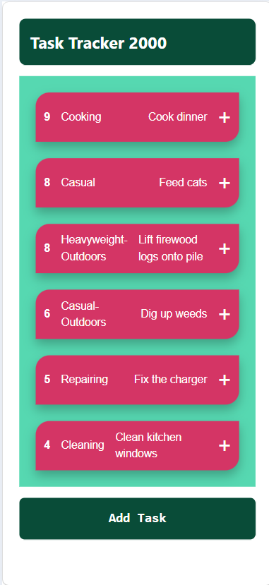

# Sprint 4 - Developing a Refined and Complete System

## Sprint Goals

Develop the system until it is fully featured, with a refined UI and it satisfies the requirements. The system will be fully tested at this point.

### Specific Goals

**Edit these goals as needed**

- Refine the design and UI of the website
- Refine the user experience (UX) of the system
- Perform final, full-system testing

## Testing the text layout of the task list page

I am testing whether the layout of the text in the task list page is easy to understand and visually pleasing. I want to make sure that the urgency, topic and task name are clearly displayed and that users can easily identify the information for each task.

**PLACE SCREENSHOTS AND/OR ANIMATED GIFS OF THE TESTING HERE**

### Changes / Improvements

This test went well. The urgency and topic of each task are displayed on the left-hand side, whereas the task name and button to access the task details are positioned on the right. This makes the information easier to read and allows users to quickly identify each task. The layout was successful and did not require any further changes.

**PLACE SCREENSHOTS AND/OR ANIMATED GIFS OF THE IMPROVED SYSTEM HERE**

No improvements or changes were needed to fix or improve the text layout of the task list page

## Testing the add task form text layout

I am testing whether the Add Task form is easy to understand and use. I am checking that all input fields are clearly labelled and organised, including the topic, name, description, estimated task time, completion date and urgency. I am also checking whether the colours and buttons make the form visually appealing and easy to navigate.

**PLACE SCREENSHOTS AND/OR ANIMATED GIFS OF THE TESTING HERE**

### Changes / Improvements
This test went well as the form has a clear and organised layout. The mint green background separates the input fields from the white page, while the dark green heading makes the title stand out. The green Add button and pink Cancel button are easy to distinguish. Overall, the design is consistent with the rest of the website and makes the form easier to use.

**PLACE SCREENSHOTS AND/OR ANIMATED GIFS OF THE IMPROVED SYSTEM HERE**

No improvements or changes were needed to fix or improve the task form UI

## Testing the color pallete of the website

I am testing whether the colour palette used throughout the website is visually appealing and makes the system easy to use. I am checking whether the different colours work well together and whether there is enough contrast between the background, task cards, buttons and text. I want the colours to create a consistent design throughout the website while keeping all the information easy to read.

**PLACE SCREENSHOTS AND/OR ANIMATED GIFS OF THE TESTING HERE**

### Changes / Improvements

This test went well as the selected colour palette created a consistent and visually appealing appearance throughout the website. The dark green was used for the main headings and buttons, while the lighter green was used for the task list background. The pink task cards provide contrast against the green background, making individual tasks stand out. The white text also makes the information easy to read. Overall, the colour palette improved the appearance of the website and made the interface more organised and user-friendly.

**PLACE SCREENSHOTS AND/OR ANIMATED GIFS OF THE IMPROVED SYSTEM HERE**

No improvements or changes were needed to fix or improve the overall color pallete of the webstie

## Sprint Review

This sprint 4 went well, the more visual UI components of the website was tested ensuring the user was visually pleased with the layout, text layout and color pallete this website provided
